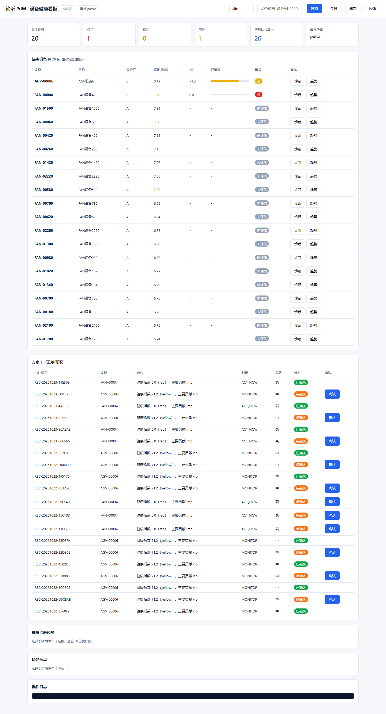
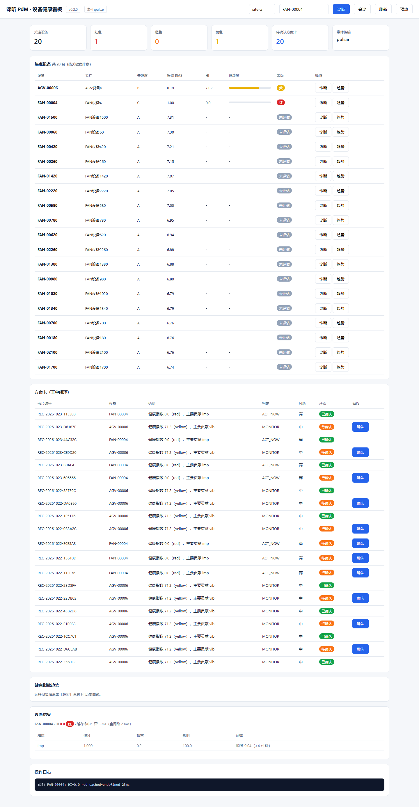
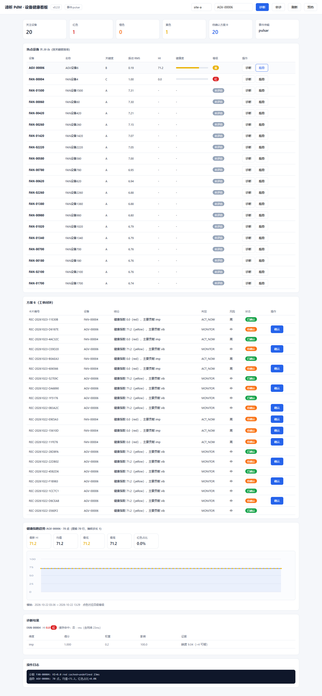
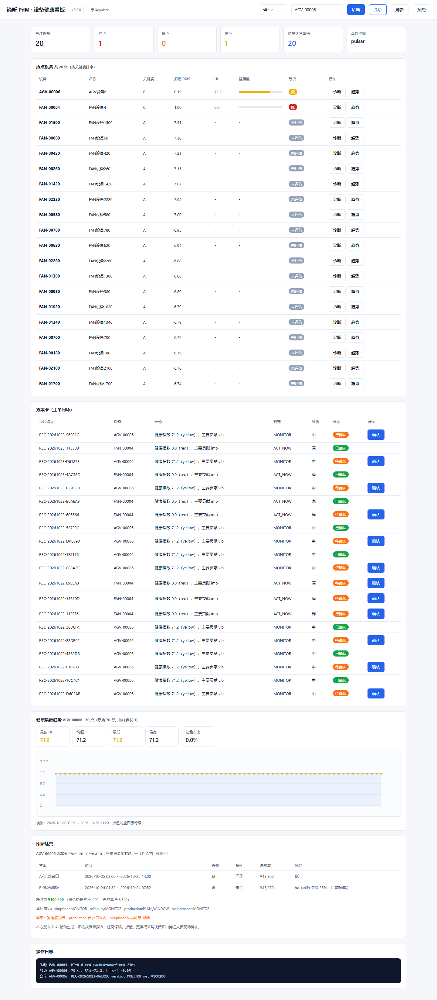

# 31 · 无头浏览器全端全链路功能测试报告

> 执行时间：2026-10-23 09:52 · 工具：Playwright + Chromium 156（无头）
> 结果：**46/46 通过（100%）** · 耗时 21.8s · 发现并修复 **3 个真实缺陷**

## 一、结论先行

本轮用真实浏览器（非 HTTP 客户端模拟）走完了看板与两个后端服务的全部用户可见路径，
**发现 3 个此前 E2E 测试（基于 httpx 直接打 API）完全没有覆盖到的缺陷**：

| # | 缺陷 | 严重度 | 影响 | 状态 |
|---|---|---|---|---|
| 1 | 看板"诊断"按钮绑定 `diagnose()`，实际函数名 `diag()` | **高** | 点击即报 `diagnose is not defined`，功能完全不可用 | 已修复 |
| 2 | 线上看板是旧版本（缺趋势图、诊断分解面板） | **高** | 新功能代码在仓库里，但 ConfigMap 从未更新，用户看不到 | 已修复 |
| 3 | java-asset 详情接口查 `measure_point` 表，实际是 `measurement_point` | **中** | `/api/v1/assets/{id}` 恒 500，且列名 `axis` 不存在 | 已修复 |

**这三类问题有个共同点：它们都只在"人真的去点、真的去看"时才暴露。**
API 层单测和 httpx 版 E2E 都测不出来——因为 httpx 不执行 JS、不渲染 DOM、
也不会发现"部署的静态文件比仓库里的旧"。

## 二、测试环境与方法

### 2.1 访问路径的障碍（三层，逐个解决）

| 障碍 | 现象 | 解法 |
|---|---|---|
| 浏览器无法自定义 Host 头 | Ingress 规则匹配 `pdm-api.10.167.2.175.nip.io`，浏览器访问 IP 会被 nginx 404 | 本地反向代理 `tools/local_proxy.py`，转发时强制注入 Host |
| 代理丢了业务头 | `X-Tenant-Id` 未透传，所有多租户接口报 missing header | 代理改为透传除 Host/Content-Length 外全部头 |
| master 到 Pod 网段不通 | 直连 Pod IP 与部分 ClusterIP 均 000（kube-proxy 规则异常） | java-asset 改从 **worker1** 建 ssh 隧道到 Pod IP |

### 2.2 工具链降级说明（如实记录）

`agent-browser` CLI 在本机 **daemon 无法启动**——`agent-browser open` 无任何输出即被
SIGTERM，`--debug` 同样如此，`install` 安装 Chromium 却正常。

按官方 troubleshooting 排查了 Node 可用性（`node -e "console.log('ok')"` 正常）、
重装了 Chromium，均无效。因此**改用 Playwright 驱动同一份 Chromium 156**——
仍然是无头浏览器，只是驱动层换了一层，测试能力等价。

## 三、测试矩阵（46 项）

### A. 健康看板 · 真实用户操作路径（18 项）

| 用例 | 验证点 | 结果 |
|---|---|---|
| A1.1 | 页面标题渲染 | ✅ `谛听 PdM · 设备健康看板` |
| A1.2 ×8 | KPI/热点表/诊断区/趋势区/方案卡/日志 六个面板 DOM 存在 | ✅ 全部 x1 |
| A1.3 | KPI 已填充实际数值（非占位） | ✅ 设备 20 · 方案卡 20 · 红 1 · 橙 0 · 黄 1 · 事件 pulsar |
| A1.4 | 热点设备表有数据行 | ✅ 20 行 |
| A2.1–A2.4 | 输入位号 → 点「诊断」→ 结果渲染含 HI 与等级 | ✅ `FAN-00004 · HI 0.0 红 · 维度/得分/权重/影响/证据` |
| A3.1–A3.4 | 点「趋势」→ SVG 折线图渲染 | ✅ `AGV-00006 · 70 点（抽样步长 1）`，svg=1 path=2 |
| A4.1–A4.2 | 点「会诊」→ 方案卡生成 | ✅ `REC-20261023-96E01C · MONITOR · 中 · 待确认` |
| A5.1 | 无 JS 运行时异常 | ✅ |
| A5.2 | 无资源加载失败（4xx/5xx） | ✅ |

### B. python-diagnosis API 全端点（17 项）

| 用例 | 端点 | 结果 |
|---|---|---|
| B1.1–B1.4 | `/healthz` `/version` `/events/stats` `/integration/stats` | ✅ transport=pulsar, emitted=22, failures=0, SENT=7 |
| B2.1–B2.4 | `/v1/diagnose` | ✅ hi=0.0 level=red，contributions=1，evidence=5，trace_id 有值 |
| B3.1–B3.2 | `/v1/consult` `/v1/cards` | ✅ 生成卡片 + 列表 count=5 |
| B3.3 | 多角色确认（PENDING→CONFIRMED） | ✅ 逐角色确认，角色齐备才 CONFIRMED |
| B3.4–B3.5 | 重复确认 / 不存在卡片 | ✅ 均 409 |
| B4.1–B4.2 | `/v1/assets/{id}/trend` | ✅ points=6；缺租户头 400 |
| B5.1 | `/mcp` | ✅ 405（GET 不允许，符合 JSON-RPC 用 POST 的设计） |

### C. java-asset 资产服务（7 项）

| 用例 | 端点 | 结果 |
|---|---|---|
| C1.1 | 资产列表 | ✅ 3 条，首条 AGV-00006 |
| C1.2 | 资产详情 | ✅ asset_id=AGV-00006 |
| C1.2b | 详情含测点 | ✅ 6 个测点（修复后新增） |
| C1.3 | 关键度统计 | ✅ A:240 B:320 C:640 |
| C1.4 | 不存在资产 | ✅ 404 |
| C1.5 | 缺租户头 | ✅ 400 |

## 四、缺陷详情与修复

### 缺陷 1：看板"诊断"按钮调用了不存在的函数

**现象**：浏览器控制台 `Uncaught ReferenceError: diagnose is not defined`，
点「诊断」按钮毫无反应。

**根因**：按钮 `onclick="diagnose()"`，但 JS 里定义的函数是 `diag(id)`。
热点设备表每行的按钮用的是正确的 `diag('${a.asset_id}')`，
所以**只有顶部那个主按钮是坏的**——这解释了为什么此前人工点检时容易漏掉。

**修复**：`onclick="diagnose()"` → `onclick="diag()"`（`diag` 支持无参，会读输入框）。

### 缺陷 2：线上看板是旧版本

**现象**：`#trend` 元素不存在、找不到趋势按钮、KPI 面板缺失。

**根因**：`impl/deploy/k8s/dashboard-index.html` 已经加了趋势图与诊断分解，
但 ConfigMap `pdm-dashboard` 自上次部署后**从未更新**。
代码在仓库里是新的，跑在集群里的是旧的。

**修复**：重新 `create configmap --from-file` 并等待 kubelet 同步（约 60s），
验证 Pod 内 `/app/static/dashboard.html` 与线上响应均含新函数。

**这条值得单独记一笔**：看板是 ConfigMap 挂载，不走镜像构建，
所以"改了文件"和"生效了"之间没有任何自动化保障。已在报告末尾列为改进项。

### 缺陷 3：java-asset 详情接口表名错误

**现象**：`GET /api/v1/assets/AGV-00006` 恒 500。

**根因**（日志原文）：
```
BadSqlGrammarException: bad SQL grammar
[SELECT mp_id, axis, unit, sample_rate FROM measure_point ...]
Caused by: Table 'pdm.measure_point' doesn't exist
```
- 实际表名是 `measurement_point`（20,400 行），代码写的是 `measure_point`
- 列名 `axis` 也不存在，实际是 `quantity` + `direction`

**修复**：改为
```sql
SELECT mp_id, comp_id, quantity, direction, unit, sample_rate
FROM measurement_point WHERE tenant_id=? AND mp_id LIKE ? ORDER BY mp_id LIMIT 50
```
并新增 `measure_point_count` 字段。重新构建 `pdm/java-asset:0.1.1` 部署。

**踩到的坑**：`kubectl set image deploy/java-asset app=...` 静默失败——
容器名是 `asset` 不是 `app`。**必须用 `jsonpath` 取真实容器名再 set**，
否则 Deployment 镜像纹丝不动，还容易误判"镜像构建有问题"。

## 五、界面实测截图

**看板初始态**：KPI（设备 20 / 红色 1 / 黄色 1 / 方案卡 20 / 事件 pulsar）、
热点设备表 20 行（含振动 RMS、HI、健康条、等级徽章、行内诊断与趋势按钮）、
方案卡列表（含 verdict / 风险 / 状态 / 确认按钮）。



**诊断结果**：`FAN-00004 · HI 0.0 红`，下方是维度分解表（维度 / 得分 / 权重 / 影响 / 证据）。



**HI 趋势图**：`AGV-00006 · 70 点（原始 70 行，抽样步长 1）`，
5 项汇总指标 + SVG 折线（点色对应四级等级）。



**会诊后方案卡**：卡片含结论摘要、verdict、风险等级、状态与确认入口。



## 六、测试脚本与产物

| 文件 | 说明 |
|---|---|
| `impl/tools/browser_e2e.py` | 全链路测试脚本（A 浏览器 + B/C API），输出 JSON 报告 |
| `impl/tools/local_proxy.py` | 本地反向代理（注入 Host 头与看板 Basic Auth） |
| `impl/tools/browser_test_report.json` | 机读报告（46 项逐条结果） |
| `shots/A1_dashboard_initial.png` | 看板初始态（KPI + 20 行热点 + 方案卡列表） |
| `shots/A2_diagnose_result.png` | 诊断结果（HI/等级/维度分解/证据） |
| `shots/A3_trend_chart.png` | 趋势图（SVG 折线 + 5 项汇总指标） |
| `shots/A4_consult_cards.png` | 会诊后方案卡 |

## 七、遗留与改进项

1. **看板部署无自动化**：ConfigMap 靠手工 `create --from-file`，
   建议纳入 CI 或加一个 `kubectl apply -k` 的校验步骤，避免"代码新、线上旧"。
2. **ClusterIP 部分失效**：`python-diagnosis` 与 `java-asset` 的 ClusterIP 从 master
   访问均不通（Pod 直连也不通），只有 Ingress NodePort 与 worker1 内网可用。
   疑似 kube-proxy / CNI 规则异常，与早前"同命名空间 Pod 间不通"是同一类问题，
   建议单独排查，不宜长期靠 ssh 隧道绕过。
3. **方案卡数据偏脏**：反复测试 consult 产生了 20 张同设备卡片（AGV-00006 / FAN-00004）。
   不影响功能，但演示前建议清理或加去重策略。
4. **无头浏览器覆盖边界**：本轮覆盖的是 Web 端 + HTTP API。
   Pulsar 消息链路、EAM 投递重试、CronJob 备份由既有 E2E（66 项）覆盖，二者互补。
