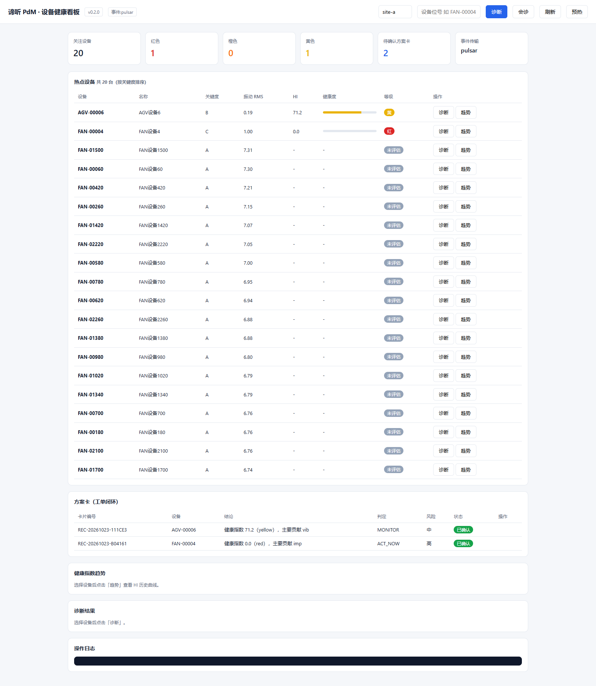
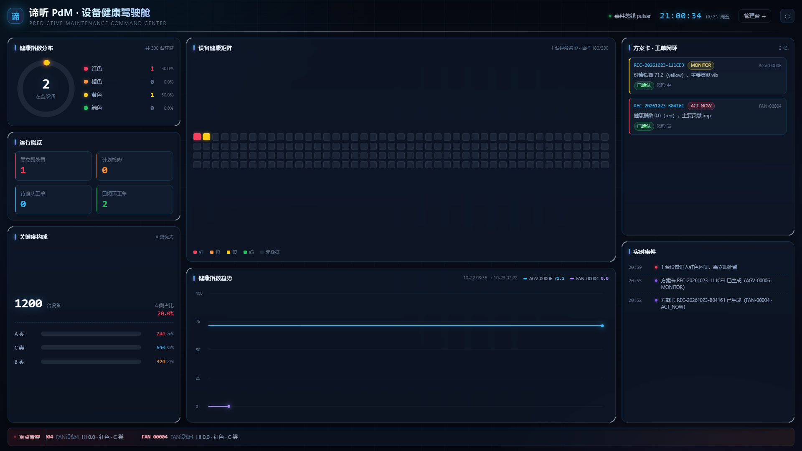
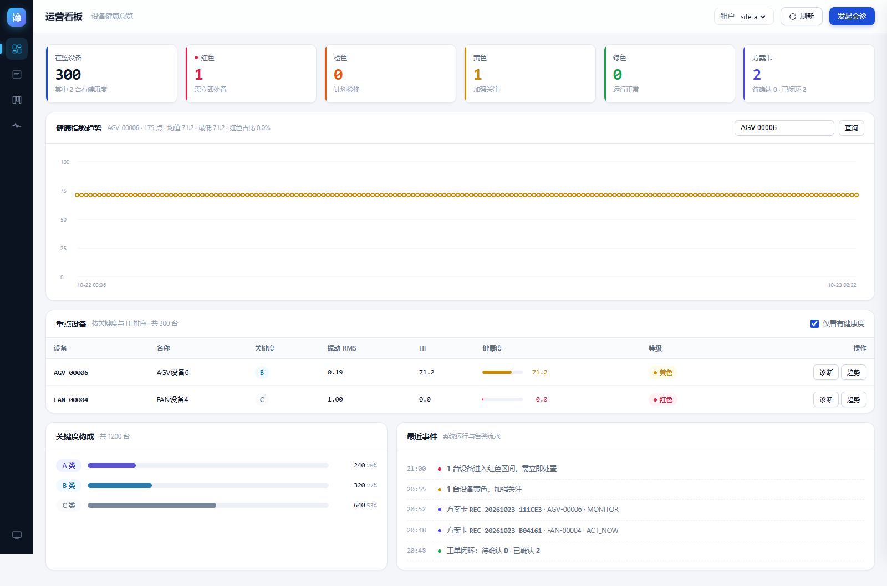
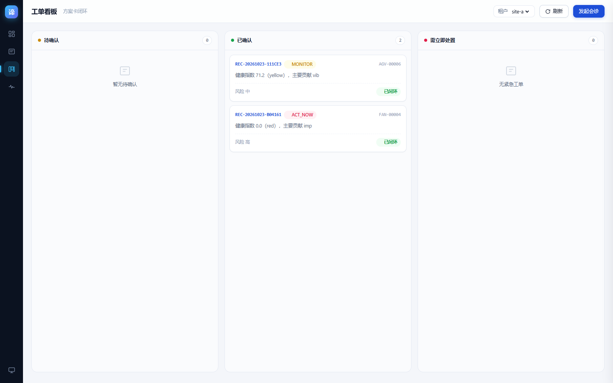
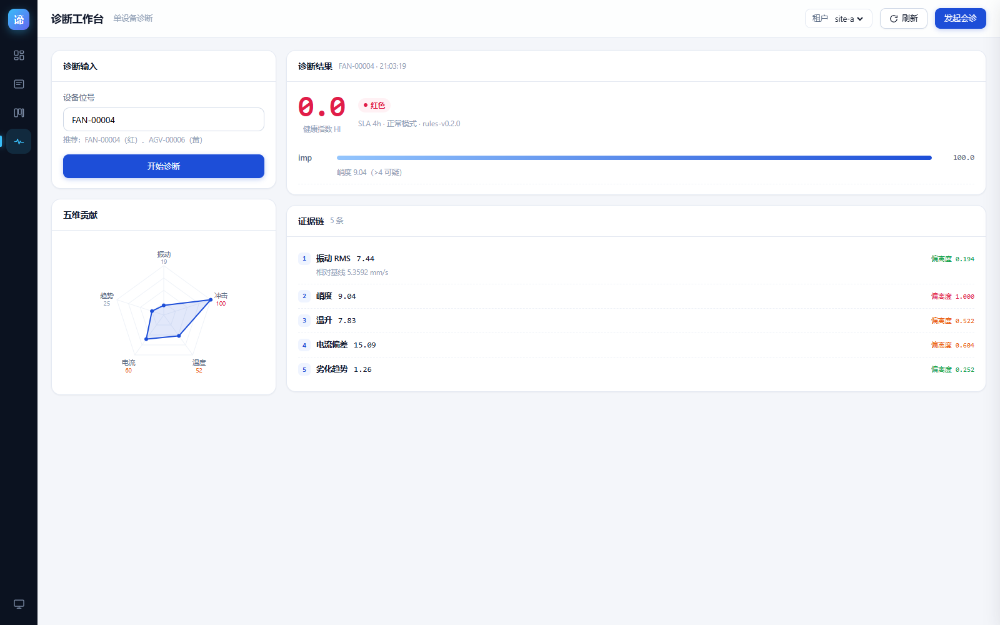

# 35 · 前端改版交付：从单页看板到双主题多端

> 基于 [34_前端设计审查与改版方案](34_前端设计审查与改版方案.md) 的 10 项问题
> 结果：**5 个页面/视图 + 7 类手写图表，自动化测试 72/72**

---

## 一、改版前后对比

### 1.1 首屏观感

**改版前**（1600×1000，单页看板）



问题一眼可见：一大片表格吃掉首屏，趋势/诊断/日志三个空面板挤在底部，
20 行里 15 行是"未评价 + 横杠 + 空条"。

**改版后 · 大屏驾驶舱**（1920×1080）



**改版后 · 运营看板**（1600×1000）



### 1.2 10 项问题的解决情况

| # | 原问题 | 改法 | 状态 |
|---|---|---|---|
| ① | 表格占满首屏 | 大屏改四象限；管理台表格限高 + 内部滚动 | ✅ |
| ② | 空面板占 60% | 空态改为「图标 + 引导 + 快捷操作」；诊断台进入即自动诊断 | ✅ |
| ③ | 无数据行稀释 75% | 「仅看有健康度」筛选默认开启 | ✅ |
| ④ | 零数据可视化 | 7 类手写 SVG 图表 | ✅ |
| ⑤ | 视觉层级扁平 | KPI 加语义左边框 + 大数字；内容面板降底色 | ✅ |
| ⑥ | KPI 语义混乱 | `pulsar` 移出 KPI，改为顶部 LED；6 卡各有语义色 | ✅ |
| ⑦ | 色彩语义断裂 | 四级健康色贯穿 KPI / 表格 / 图表 / 徽章 | ✅ |
| ⑧ | 日志黑块突兀 | 改为浅色事件流 + 级别色点 + 时间戳 | ✅ |
| ⑨ | 无导航 | 左侧图标导航 + hash 路由，4 视图自由切换 | ✅ |
| ⑩ | 无响应式/动效 | 1366/1600/1920 三档适配；hover、进入、数字过渡 | ✅ |

---

## 二、交付内容

### 2.1 页面结构

| 页面 | URL | 主题 | 定位 |
|---|---|---|---|
| **大屏驾驶舱** | `/pdm-api/screen` | 深色 | 1920×1080 全屏投屏，一屏看全厂 |
| **管理台** | `/pdm-api/console` | 浅色 | 日常操作，4 视图 hash 路由 |
| └ 运营看板 | `#/dashboard` | 浅色 | KPI + 趋势 + 重点设备 + 关键度 + 事件 |
| └ 设备台账 | `#/assets` | 浅色 | 搜索 + 双维筛选 + 抽屉详情 |
| └ 工单看板 | `#/cards` | 浅色 | 三栏 Kanban（待确认/已确认/紧急） |
| └ 诊断工作台 | `#/diagnose` | 浅色 | 输入 → 诊断 → 雷达图 → 证据链 |
| 经典看板 | `/pdm-api/dashboard` | 浅色 | 保留兼容旧链接 |

### 2.2 双主题设计系统

两套主题共享语义，仅换色值：

```
语义色（两主题共用）
  红 #F43F5E / 橙 #FB923C / 黄 #FACC15 / 绿 #22C55E
主色
  深色大屏  #38BDF8（天青，带发光）
  浅色管理台 #1D4ED8（靛蓝，带轻阴影）
中性
  深色 7 级：bg #050810 → panel rgba(14,23,40,.72) → txt #E8F0FB
  浅色 7 级：bg #F4F6FA → panel #FFFFFF → txt #0F172A
尺度
  字号 11/12/13/14/16/20/28/36/46
  间距 4 的倍数
  圆角 6/10/14/999
```

### 2.3 七类手写 SVG 图表（零 CDN）

| 图表 | 位置 | 实现要点 |
|---|---|---|
| 环形进度环 | 大屏 | `stroke-dasharray` 分段，四色带发光，中心大数字 |
| 健康矩阵点阵 | 大屏 | 180 格，**按等级排序**（异常置顶，避免被灰块淹没） |
| 多线趋势图 | 大屏 | 最多 3 台对比；**方差 < 4 时不铺面积**（避免整屏纯色块） |
| 横向条形 + 百分比 | 大屏/管理台 | 关键度构成，含总数与 A 类占比 |
| 面积折线 | 管理台 | 渐变填充、网格、X 轴时间；点数 > 40 时省略圆点 |
| 五维雷达 | 诊断台 | **固定五维**（振动/冲击/温度/电流/趋势），从 evidence 的 `s` 值映射 |
| 滚动告警 ticker | 大屏 | 双份内容 + `translateX(-50%)` 实现无缝，hover 暂停 |

**为什么不用 ECharts**：内网无外网，CDN 不可达；内联会让单文件膨胀到 1MB+，
且 ConfigMap 有大小限制。手写 SVG 每个图表 < 2KB 代码，配色完全贴合设计系统。

---

## 三、过程中修掉的 4 个实现缺陷

改版不是只换皮，过程中发现并修掉：

**① 证据链直接显示原始 JSON**

初版把 `evidence` 数组直接 `JSON.stringify` 塞进 DOM：

```
{"type":"metric","name":"vib_rms_mm_s","value":7.4433,"s":0.1944,"basis":"相对基线 5.3592 mm/s"}
```

修复：解析为「指标中文名 + 读数 + 偏离度（颜色编码）+ 依据」四段式，
并建立指标名映射（`vib_rms_mm_s` → 振动 RMS）。

**② 雷达图退化成单点**

`contributions` 只有 1 项（`imp`），按贡献度动态生成轴会让雷达图变成一个点。
修复：固定五维，从 `evidence` 的 `s` 值映射到对应维度，五轴都有值。

**③ 趋势图整屏纯色块**

175 个点、方差 0 的数据铺面积填充 → 一大块蓝色，既无信息量又压视觉。
修复：方差 < 4 时只画线不填充；点数 > 40 时省略圆点（否则连成粗虚线）。

**④ 关键度徽章与健康等级语义冲突**

A 类设备用红色徽章，与"红色=紧急"冲突。
修复：关键度改用中性色（A 靛蓝 / B 天蓝 / C 灰），健康等级独占四级语义色。

---

## 四、验证

### 4.1 自动化测试 72/72

新增 23 项页面测试（D 组）：

| 组 | 覆盖 | 项数 |
|---|---|---|
| D1 大屏 | 环形/图例/矩阵/条形/事件/滚动条/SVG/无横向滚动/无 4xx/无 JS 异常 | 11 |
| D2 管理台 | 4 视图渲染 + 标题 + 诊断台自动出证据 + 雷达五维 + 导航高亮 + 无 4xx/JS | 12 |

回归：原 49 项浏览器测试 + 66 项 E2E + 72 项单测，全部通过。

### 4.2 响应式

| 视口 | 结果 |
|---|---|
| 1920×1080 | 大屏无横向滚动（`scrollWidth = 1920`） |
| 1600×1000 | 管理台四视图正常 |
| 1366 宽 | 布局降级为单列（媒体查询 ≤1200） |

### 4.3 管理台其余视图

| 设备台账 | 工单看板 | 诊断工作台 |
|---|---|---|
|  |  |  |

---

## 五、部署与访问

### 5.1 访问地址（局域网）

```
大屏驾驶舱  http://pdm-api.10.167.2.175.nip.io:32231/pdm-api/screen
管理台      http://pdm-api.10.167.2.175.nip.io:32231/pdm-api/console
经典看板    http://pdm-api.10.167.2.175.nip.io:32231/pdm-api/dashboard
账号        pdmadmin / 3r5P-ygrg-WAcK-W0yB-Vz1q
```

大屏建议全屏投屏（页面右上角有全屏按钮），管理台左侧图标可切换四视图。

### 5.2 部署方式

三个页面都走 ConfigMap 挂载（`pdm-dashboard`，3 个 key），**不经镜像构建**：

```bash
cd impl
bash tools/deploy_dashboard.sh verify   # 校验一致性
bash tools/deploy_dashboard.sh deploy   # 部署 3 页并逐页验证 200
```

脚本已升级为多页面：上传 → 更新 ConfigMap（3 个 key）→ 轮询 Pod 内同步 →
逐页 HTTP 校验。

---

## 六、技术债与后续

| 项 | 说明 |
|---|---|
| 数据稀疏 | 当前仅 2 台设备有健康度，图表信息量受限。属测试数据问题，非设计问题 |
| 无图表库 | 手写 SVG 可控但扩展成本高于 ECharts。若后续要加 10+ 图表，建议内联轻量库 |
| 无暗色管理台 | 目前只有大屏是深色。若需全站深色，可在 `console.html` 加 `prefers-color-scheme` 分支 |
| 无权限分级 | 所有视图对同一账号开放。生产需按角色隐藏"确认工单"等写操作 |
