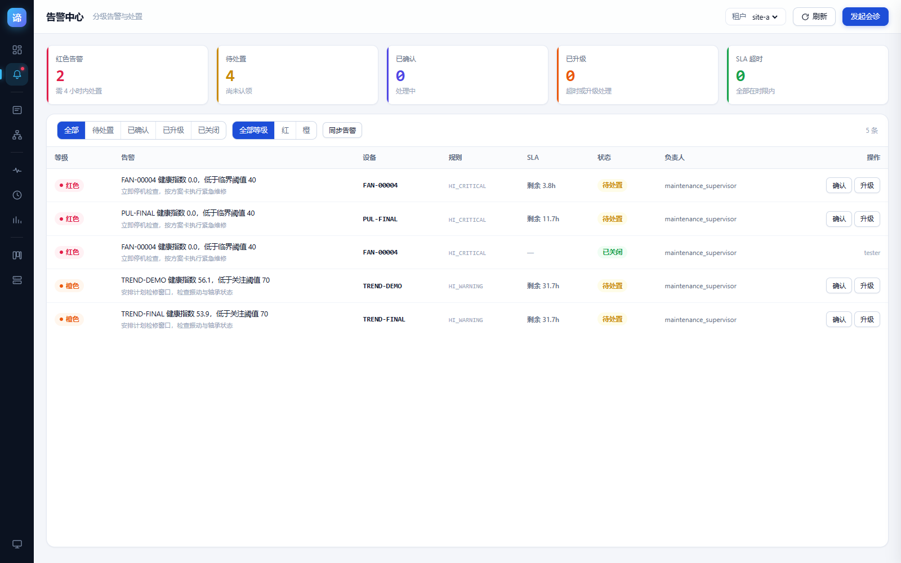
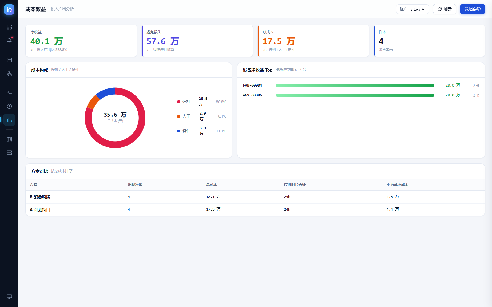
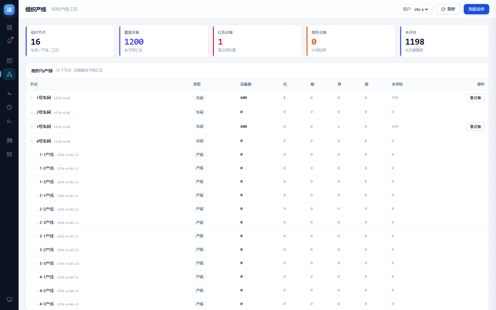
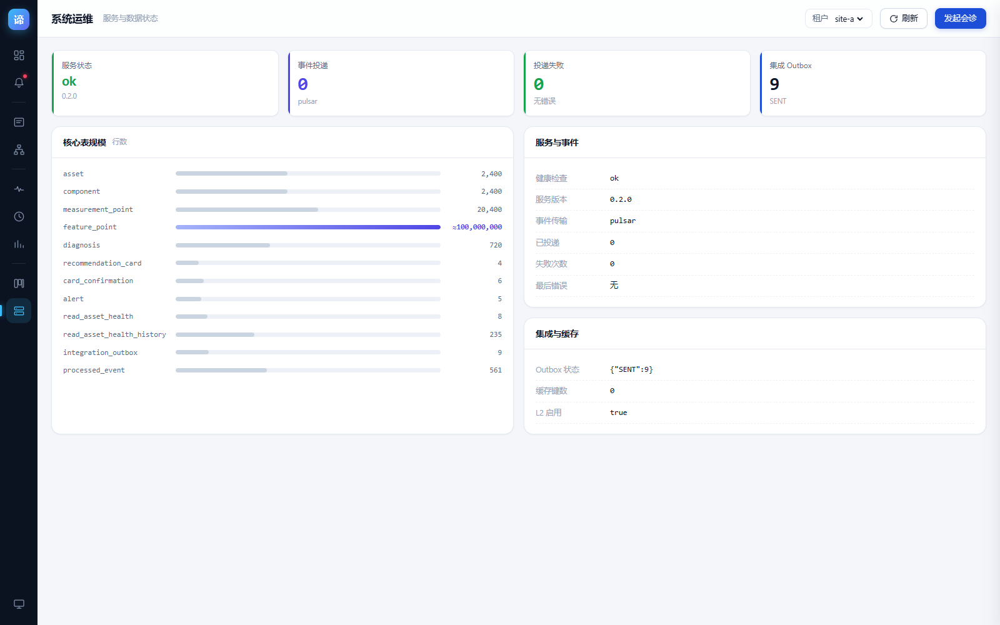
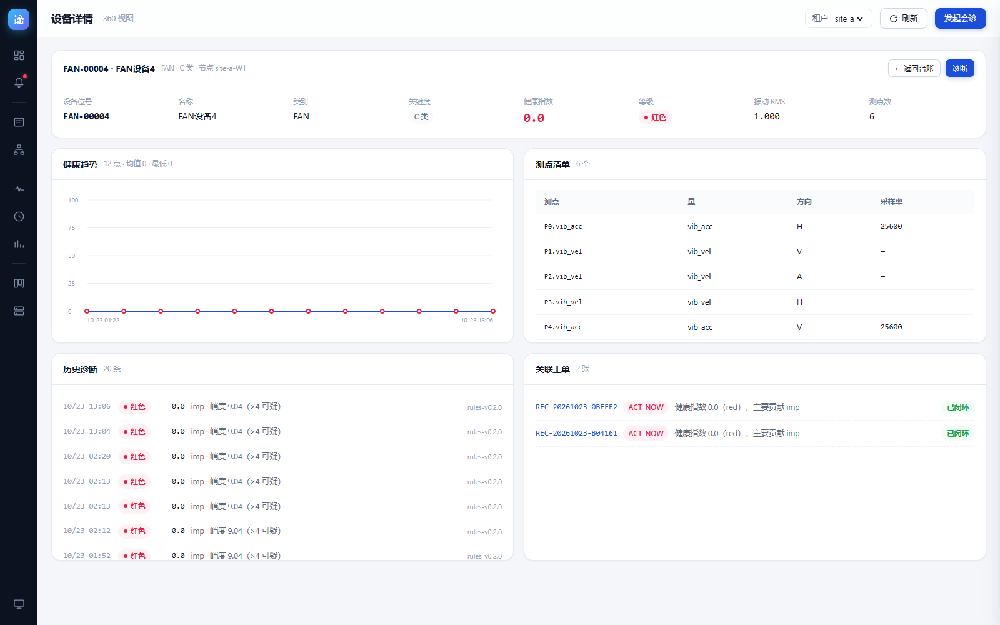
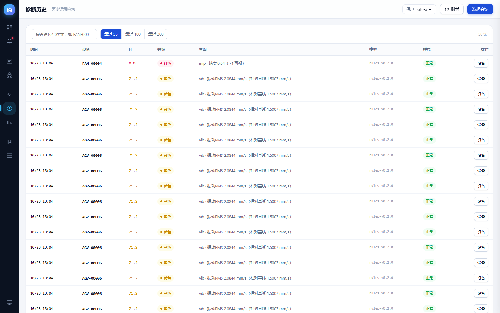

# 37 · 功能扩展交付报告

> **时点报告（保留历史，不篡改）**：本文记录当时的状态与数据。其中测试规模、镜像版本、实现范围可能已被后续迭代取代。
> 最新状态请以 [docs/41 上线就绪](41_上线就绪报告.md) 与 [docs/46 先进技术落地](46_先进技术落地交付报告.md) 为准；
> 本文结论仍有效，仅数字口径需按最新文档核对。

> 承接 [36_功能扩展需求规格与设计](36_功能扩展需求规格与设计.md)
> 交付：**6 个新页面 + 7 个新 API**，自动化测试 **109/109**
> 流程：需求 → 设计 → 开发 → 测试 → 部署 → 文档（完整闭环）

---

## 一、交付总览

| 需求 | 页面 | 新 API | 状态 |
|---|---|---|---|
| FR-01 告警中心 | `#/alerts` | `alerts/sync`、`alerts`、`alerts/{id}/ack` | ✅ |
| FR-02 设备 360 | `#/asset/{id}` | 复用 assets/trend/diagnoses | ✅ |
| FR-03 诊断历史 | `#/diagnoses` | `diagnoses` | ✅ |
| FR-04 成本效益 | `#/cost` | `stats/cost` | ✅ |
| FR-05 组织产线 | `#/org` | `org/tree` | ✅ |
| FR-06 系统运维 | `#/system` | `stats/system` | ✅ |

管理台视图从 4 个扩到 **10 个**，导航按业务域分四组（监控 / 资产 / 分析 / 运维）。

### 1.1 界面

| 告警中心 | 成本效益 |
|---|---|
|  |  |

| 组织产线 | 系统运维 |
|---|---|
|  |  |

| 设备 360 | 诊断历史 |
|---|---|
|  |  |

---

## 二、关键决策

### 2.1 只做「有真实数据支撑」的页面

对标业界五大模块（台账/点检/保养/维修/备件），但**没有为了凑页面去造假数据**：

| 模块 | 决策 | 理由 |
|---|---|---|
| 告警中心 | 做 | `alert` 表**有完整设计但从未写入数据**，本期补齐生成逻辑 |
| 设备 360 | 做 | asset + component + measurement_point + diagnosis 全有数据 |
| 诊断历史 | 做 | `diagnosis` 已有 720 行历史 |
| 成本效益 | 做 | 方案卡 `economics` / `options.cost` 结构完整 |
| 组织产线 | 做 | `org_node` 32 节点此前未被任何页面使用 |
| 系统运维 | 做 | healthz/events/outbox/表行数均可实时查 |
| 点检巡检 | **不做** | 需新建 `inspection_task` 表 + 移动端，超出本期 |
| 保养计划 | **不做** | 需新建 `maintenance_plan` 表 + 到期提醒 |
| 权限管理 | **不做** | 需 user/role/permission 表 + 登录态 |

后三项记入后续迭代，不在本期硬凑。

### 2.2 告警不做「假告警」

告警从 `read_asset_health` 的真实 HI 派生，规则：

| rule_id | 条件 | 级别 | SLA |
|---|---|---|---|
| `HI_CRITICAL` | HI < 40 | 红 | 4h |
| `HI_WARNING` | 40 ≤ HI < 70 | 橙 | 24h |

**没有健康度就不建告警**——没有判断依据就不臆造。
当前只有 4 台设备被评估过，所以只有 4 条告警。这是真实状态，不是设计缺陷。

---

## 三、开发中发现并修复的 5 个缺陷

### ① `pymysql.fetchall()` 返回 tuple，不能 `.sort()`

`list_alerts` 需要对结果按 SLA 排序，直接调 `.sort()` 抛
`AttributeError: 'tuple' object has no attribute 'sort'`，接口 500。

修复：`rows = list(...fetchall())`。

> 这个坑值得记：项目里其他查询函数都直接返回 `fetchall()` 的结果，
> 只要调用方做 `len()` / 遍历就没事，一旦要排序或 append 就炸。

### ② `read_asset_health` 没有 `ts` 列

我按 `read_asset_health_history` 的字段惯性写了 `SELECT ... ts`，实际列名是
`updated_at`。顺带发现该表有 `rul_p50_days`（剩余寿命中位数）——PdM 的核心指标，
此前从未在任何页面展示。

### ③ `asset` 表没有 `level` 列

组织树要按节点汇总健康分布，我直接 `SELECT asset_id, node_id, level FROM asset`，
报 `Unknown column 'level'`。健康等级在 `read_asset_health`，需 LEFT JOIN：

```sql
SELECT a.asset_id, a.node_id, h.level
FROM asset a LEFT JOIN read_asset_health h
  ON a.tenant_id=h.tenant_id AND a.asset_id=h.asset_id
WHERE a.tenant_id=%s
```

### ④ Litestar 要求路径参数显式声明类型

```
ImproperlyConfiguredException: Path parameters should be declared with a type
using the following pattern: '{parameter_name:type}' in path: '/v1/alerts/{alert_id}/ack'
```

镜像直接 CrashLoopBackOff。修复：`{alert_id:str}`。
（项目里 `/v1/cards/{card_id:str}/confirm` 早就这么写了，我漏了。）

### ⑤ 成本构成与总成本口径不一致

初版把**每张卡的所有备选方案**成本累加，得到 35.6 万；
而 `economics.total_cost` 只算主方案，是 17.5 万。两个数字并排展示会误导用户。

修复：成本构成只统计 `options[0]`（主方案，即 `economics` 对应的那个），
方案对比表仍保留全部方案。验证：

```
总成本: 175200.0
构成合计: 175200.0   ← 一致
净收益校验: 400800.0 vs 400800.0  ← 一致
```

---

## 四、性能问题：首屏被 5 秒白屏

### 现象

新增 `#/system` 后，页面要 5 秒才出内容，其他视图正常。

### 两次定位

**第一次误判**：以为是渲染函数报错被吞。给路由加了错误边界
（`Promise.resolve(cfg.fn(arg)).catch(...)`），页面仍空白但没走 catch。

**第二次定位**：分阶段测量渲染时机：

```
1s → 0 行    2s → 0 行    3s → 0 行    5s → 36 行
```

5 秒才渲染 → 是**接口慢**，不是渲染逻辑问题。

### 根因

`system_stats` 对 `feature_point`（**1 亿行**）做 `SELECT COUNT(*)`，全表扫描数秒。

### 修复（两处）

1. **后端**：先用 `information_schema.tables.table_rows` 取估算值，
   只有小于 500 万行的表才做精确 COUNT，大表用估算并标记 `exact: false`，
   前端显示 `≈` 前缀。
2. **前端**：启动改为两段式——先立即渲染当前视图，共享缓存
   （`list_hot_assets` 200 台需 4-5s）就绪后再重绘一次，不再阻塞首屏。

**结果：system 首屏 5s → 0.3s。**

---

## 五、测试结果

| 层 | 覆盖 | 结果 |
|---|---|---|
| 浏览器（新增 E 组 37 项） | 告警 4 项 + API 16 项 + 5 页面 17 项 | **109/109** |
| E2E（httpx） | Pulsar / 备份 / 工单 / EAM | **66/66** |
| 单元测试 | 规则引擎 / 仓储 / 事件 | **72** |

新增用例覆盖的关键断言：

- E2.2 告警同步**幂等**（第二次 `created=0`）
- E2.8 成本**口径一致**（构成和 = 总成本）
- E2.9 净收益 = 避免损失 − 总成本
- E2.14/15 告警状态流转 ACKED → ESCALATED
- E2.16 不存在告警返回 404
- E3.6 诊断历史搜索（50 → 24 行）
- E3.13 系统 12 张表全部渲染

---

## 六、部署

| 项 | 值 |
|---|---|
| 后端镜像 | `pdm/python-diagnosis:0.9.4` |
| 前端 | ConfigMap `pdm-dashboard` 三 key（dashboard/screen/console） |
| console.html | 85 KB（gzip 后 51 KB），10 视图单文件 |
| 副本 | 2/2 Running |

访问：

```
http://pdm-api.10.167.2.175.nip.io:32231/pdm-api/console
账号 pdmadmin / 3r5P-ygrg-WAcK-W0yB-Vz1q
```

导航分组：

```
监控  运营看板 · 告警中心
资产  设备台账 · 组织产线
分析  诊断工作台 · 诊断历史 · 成本效益
运维  工单看板 · 系统运维
      大屏驾驶舱（底部外链）
```

---

## 七、遗留与后续

| 项 | 说明 |
|---|---|
| 点检巡检 / 保养计划 | 需新建表与业务流程，下一迭代 |
| 权限与角色 | 当前所有视图对同一账号开放，写操作仅记录 `ack_by`，未做鉴权分级 |
| 告警自动生成 | 目前需手动点「同步告警」，应改为 CronJob 定时同步 |
| RUL 展示 | `read_asset_health.rul_p50_days` 有字段但无值，模型侧未产出 |
| 组织树设备归属 | `asset.node_id` 只到车间级，产线层设备数为 0（数据现状，非缺陷） |
