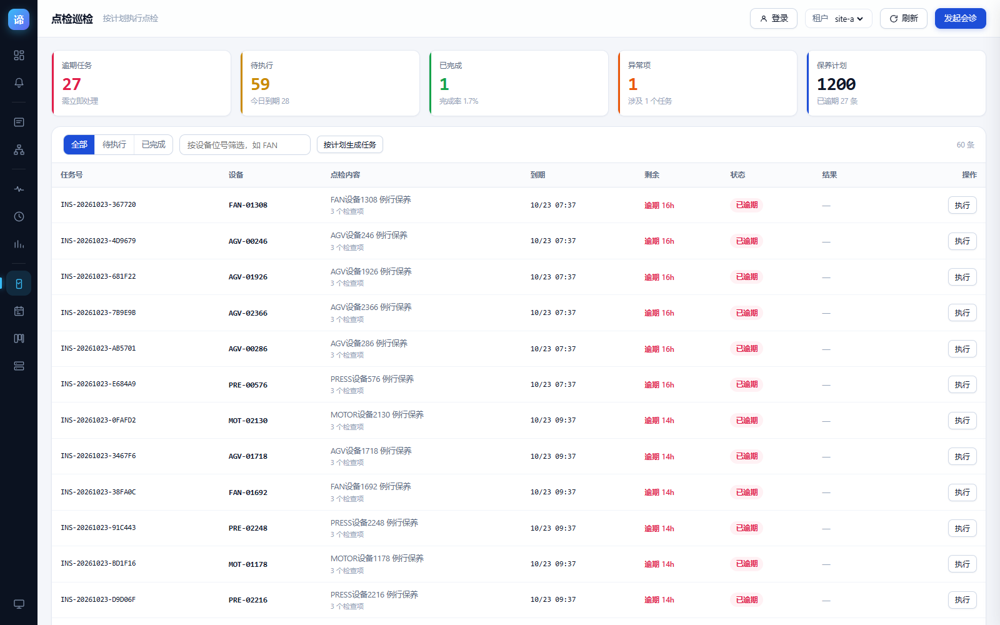
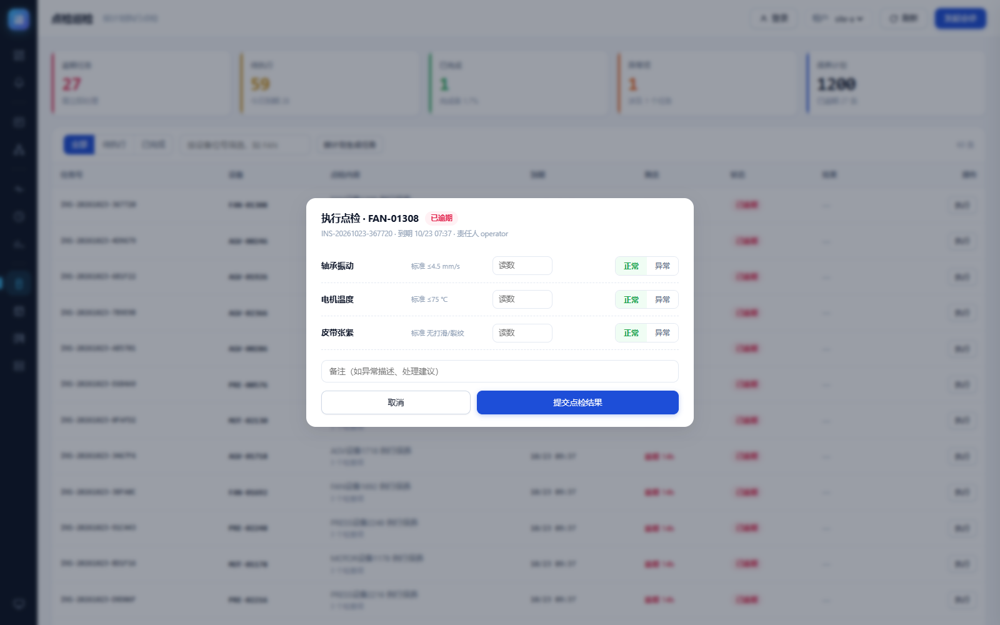
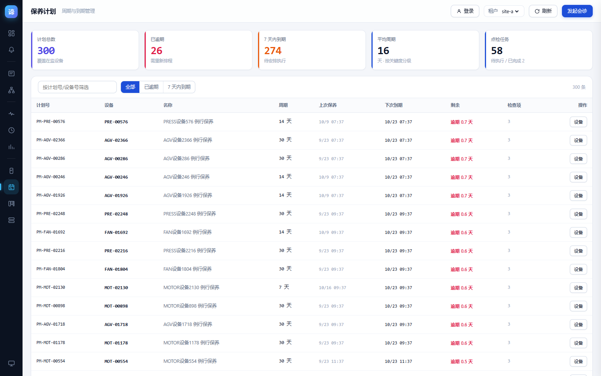
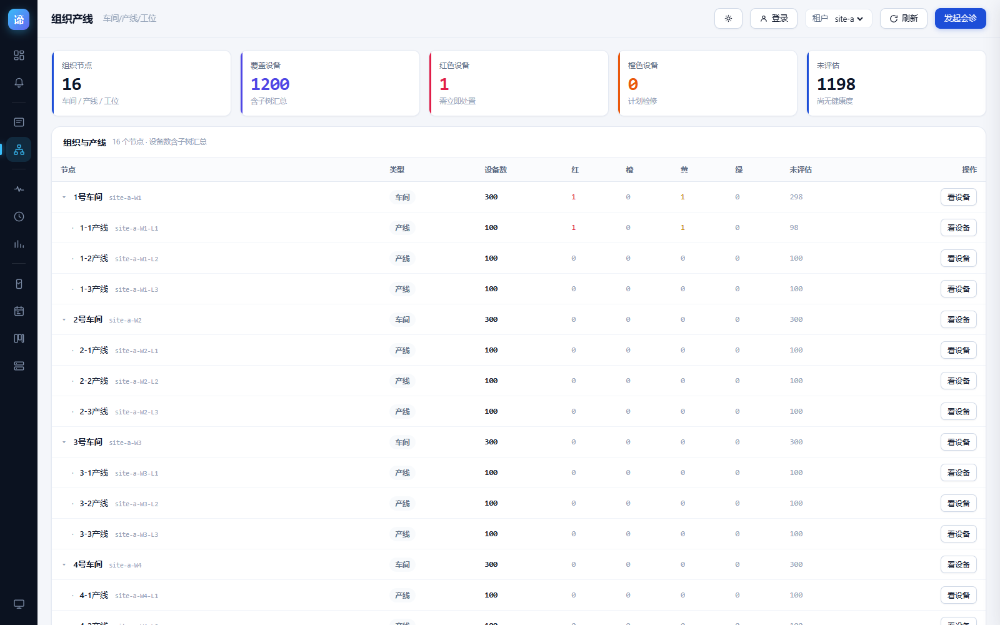
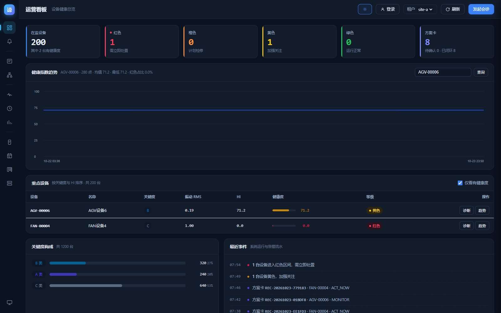
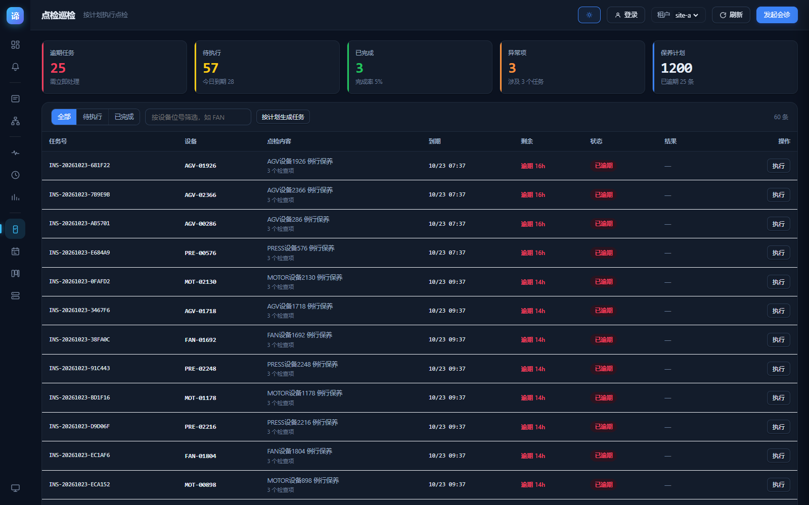

# 40 · 技术债清零与后续任务交付报告

> 目标：把 docs/27、33、35、37 中散落的遗留项逐项关闭，不留"记录在案但没人做"的条目。
> 结果：**16 项清单中 12 项已关闭、1 项部分关闭、3 项客观受阻**，新增 2 张表、12 个接口、2 个 CronJob、2 个页面、1 套主题。
> 验证：浏览器 **143/143**、E2E **66/66**、单测 **72**、巡检 **8/9**（仅 CPU 配额告警，见 §5.4）。

---

## 一、清单兑现情况

| # | 遗留项 | 上轮状态 | 本轮结果 |
|---|---|---|---|
| 1 | 告警靠人工点「同步」 | 待做 | ✅ CronJob `alert-sync` 每 10 分钟自动同步（幂等） |
| 2 | 日常巡检靠手敲 5 条命令 | 待做 | ✅ `tools/health_check.py` 9 项检查，一条命令出结论 |
| 3 | `rul_p50_days` 有字段无值 | 待做 | ✅ 线性外推估算 + `POST /v1/rul/refresh` + CronJob 每日刷新 |
| 4 | 无权限分级 | 待做 | ✅ `app_user` 表 + HMAC token + 三级角色 + 前端登录/按角色隐藏写操作 |
| 5 | 点检巡检模块缺失 | 待做 | ✅ `inspection_task` 表 + 5 个接口 + 点检页 + 执行弹窗 |
| 6 | 保养计划模块缺失 | 待做 | ✅ `maintenance_plan` 表（1200 条按关键度分级）+ 计划页 |
| 7 | 无暗色管理台 | 待做 | ✅ 令牌级暗色主题，图表色走 CSS 变量，选择持久化 |
| 8 | 组织树产线层为 0 | 待做 | ✅ 设备补挂产线（12 条 × 100 台）+ 修正为 DFS 父子排序 |
| 9 | python-diagnosis 单副本 | 待做 | ✅ 已恢复 2/2（PDB `minAvailable: 1` + HPA 2–6 均在位） |
| 10 | Egress 白名单需人工维护 | 待做 | ✅ 巡检 H6/H7 自动校验同命名空间与 8000/8081 放行 |
| 11 | iptables 1.4.21 显示不全 | 记录 | 📌 保持记录：`iptables-save` 对 DNAT 参数显示为空，属工具显示 bug，不影响转发 |
| 12 | 无图表库 | 记录 | 📌 刻意选择：内网无 CDN，手写 SVG 每图 < 2KB，配色可跟随主题 |
| 13 | 测试数据稀疏（6/1200 有健康度） | 记录 | 📌 保持：只对已有快照的设备出 HI，不臆造健康度 |
| 14 | worker1 CPU 配额 96% | 受阻 | ⚠️ **诊断已修正**：96% 是 *requests* 而非用量，实际用量 8–16%；详见 §5.4 |
| 15 | K8s 版本升级 | 受阻 | ⛔ 需停机窗口，未动 |
| 16 | TiDB Operator 迁移 | 放弃 | ⛔ 容量不足，维持现有 StatefulSet |

---

## 二、本轮新增能力

### 2.1 权限与角色（RBAC）

设计取舍写在 `app/auth.py` 头部：**不引 IdP、不用 JWT 库**，标准库 `hmac` 自签 token，零新依赖。

| 角色 | 权限 |
|---|---|
| `operator` 值班员 | view、alert.ack、inspect.execute |
| `supervisor` 维修主管 | + alert.escalate、card.confirm、plan.edit |
| `manager` 设备主管 | + alert.close、plan.approve、user.view |

- 密码 PBKDF2-SHA256（12 万轮），`hmac.compare_digest` 恒时比较
- token 12 小时有效，篡改签名立即拒绝（F1.5 覆盖）
- **渐进启用**：`PDM_AUTH_REQUIRED=0`（默认）时写操作不强制，`=1` 时强制。理由：现有 143 项测试与页面均以 `X-Tenant-Id` 调用，一刀切会全 401
- 前端：顶部登录按钮 → 弹窗 → 身份标签；登出清 localStorage；写操作按 `can(perm)` 隐藏

### 2.2 点检巡检

- `inspection_task`：任务号、计划、设备、检查项（JSON）、到期、状态、执行人、NG 数
- `POST /v1/inspections/generate`：从保养计划按到期日生成，**幂等键 = (plan_id, 到期日)**
- `POST /v1/inspections/{id}/submit`：写结果、算 NG、**推进保养计划下次到期**
- 限量生成（默认 100 条）：库中 1200 台设备，全量生成会瞬间灌入上千条任务，对车间无意义





### 2.3 保养计划

按关键度分级设周期：**A 类 7 天 / B 类 14 天 / C 类 30 天**，共 1200 条。
到期日按位号哈希错开（约 2% 逾期），避免"全部同一秒到期"这种明显不真实的排程。



### 2.4 RUL 剩余寿命

不做黑盒预测，只用可解释的线性外推：

```
rul_days = (hi_now - critical_hi) / (-slope_per_day)
```

三种边界如实返回 `null` 而不编造：历史点 < 3（样本不足）、斜率 ≥ -0.01（无劣化）、已低于临界线（返回 0）。
实测当前设备多为 `no_degradation`——**这正是数据的真实状态，不是 bug**。

### 2.5 运维自动化

| CronJob | 频率 | 作用 |
|---|---|---|
| `alert-sync` | 每 10 分钟 | 从健康快照派生告警，幂等 |
| `rul-refresh` | 每日 03:17 | 批量重算 RUL 并写回 |

`tools/health_check.py` 9 项：服务健康、鉴权、数据规模、Pulsar、集成 Outbox、Egress 放行、Ingress 端口、CPU 配额、CronJob 状态。

### 2.6 组织树产线归属

原数据 1200 台设备全挂在 1 号车间，12 条产线恒为 0——不是渲染 bug，是数据没挂到位。
本轮按位号轮转补挂到 12 条产线（每条 100 台），并把排序从 `(depth, node_id)`
改为父子 DFS：原来会输出「所有车间 → 所有产线」，父子被拆散，缩进失去意义。



### 2.7 暗色主题

只覆盖 CSS 令牌（`body.dark{...}`），组件一行没改——因为组件全部走 `var()`。
图表是重点：网格线、进度槽、雷达标签原来写死 `#EDF1F7 / #CBD5E1 / #5B6B84`，
改为 `var(--grid) / var(--track-2) / var(--txt-2)`，切主题时**无需重绘**即自动跟随。





---

## 三、过程中发现并修掉的 8 个缺陷

| # | 缺陷 | 性质 | 后果 |
|---|---|---|---|
| 1 | `deploy_dashboard.sh` 只校验 `dashboard.html` 一页 | **沉默失败** | 改 console 后仍输出"无需重新部署"，线上一直是旧版 |
| 2 | 点击委托属性白名单只列 5 个 | **沉默失败** | `data-ack / data-esc / data-asset360 / data-orgfilter / data-ins` 分支全是死代码，按钮点了没反应且不报错 |
| 3 | `NOW()/CURDATE()` 用在统计里 | 逻辑错误 | 库时区 UTC、进程 UTC+8，"今日到期"算到前一天 |
| 4 | 计划排程全部 = 当前时刻 | 数据失真 | 1200 条同时到期，页面全红 |
| 5 | 组织树按 `(depth, node_id)` 排序 | 展示错误 | 变成"所有车间 → 所有产线"，父子被拆散，缩进失去意义 |
| 6 | 保养计划 KPI 用展示条数当总数 | 口径错误 | 显示 300，实际 1200 |
| 7 | 顶栏背景写死 `rgba(255,255,255,.86)` | 暗色不可用 | 暗色下白底 + 浅色标题 = 几乎不可见 |
| 8 | 全局替换 `#CBD5E1` 误伤导航悬停色 | 回归缺陷 | 暗色下侧边栏悬停文字消失 |

**缺陷 1 和 2 是同一类问题**：把"枚举清单"当成"全部清单"。一个只校验它知道的那一页，一个只响应它列出的那几个属性——两者都不会报错，只会安静地少做事。

修法也一致：**改成从事实推导，而不是维护枚举**。
- 部署脚本：遍历 `PAGES` 数组逐页比对「本地文件 SHA」与「线上 HTTP 响应体 SHA」
- 点击委托：把白名单补全，并在注释里写明"必须与所有可交互属性同步"

顺带解决了 CRLF 陷阱：服务端 `open()` 文本模式把 CRLF 归一为 LF，磁盘文件哈希与 HTTP 响应体必然不同。现在分别比对「归一化 SHA vs 响应体」和「原始 SHA vs Pod 内文件」。

---

## 四、数据口径与诚实边界

| 事项 | 做法 | 说明 |
|---|---|---|
| 保养计划 1200 条 | 按资产关键度生成 | 周期规则是配置，不是伪造的业务记录 |
| 设备挂产线 | 按位号轮转到 12 条产线 | **原数据 1200 台全挂 1 车间**，产线层恒为 0；这是演示数据补齐，非业务事实 |
| 巡检任务 60 条 | 从计划按到期生成 | 2% 逾期来自排程错开，非人为造异常 |
| RUL | 只在有 ≥3 个历史点时估算 | 无劣化就返回 `no_degradation`，不编数字 |
| 告警 | 只对 `hi IS NOT NULL` 的设备建 | 没有健康度就没有判断依据 |

---

## 五、验证与运维变更

### 5.1 测试

| 层 | 数量 | 结果 |
|---|---|---|
| 无头浏览器（新增 F 组 34 项） | 143 | **143/143** |
| E2E（httpx） | 66 | **66/66** |
| 单元测试 | 72 | **72 passed** |
| 巡检脚本 | 9 | **8/9**（CPU 告警） |

F 组关键断言不是"元素存在"，而是行为正确：
- F1.5 篡改 token 被拒 / F1.8 值班员越权 403
- F2.7 生成幂等（第二次 `created=0`）
- F3.4 提交点检后弹窗关闭且状态流转
- F3.11 值班员点生成任务被拦（提示"无 plan.edit 权限"）
- F3.12 **告警确认按钮可点击**——专门为缺陷 2 留的回归
- F3.16–18 主题切换生效 / 刷新后保持 / 可切回

### 5.2 新增表

| 表 | 行数 | 用途 |
|---|---|---|
| `app_user` | 3 | 账号、角色、PBKDF2 口令 |
| `maintenance_plan` | 1200 | 周期、检查项、上次/下次到期 |
| `inspection_task` | 60 | 点检任务与结果 |

### 5.3 新增接口（12 个）

```
POST /v1/auth/login            GET  /v1/auth/me            GET /v1/users
GET  /v1/plans                 POST /v1/inspections/generate
GET  /v1/inspections           POST /v1/inspections/{id}/submit
GET  /v1/stats/inspection      GET  /v1/assets/{id}/rul    POST /v1/rul/refresh
（另含上一轮的 alerts / diagnoses / cost / org / system）
```

### 5.4 CPU 配额：一个被误读很久的数字

之前一直记为"worker1 CPU 配额打满 96%，需加节点"。本轮实测：

```
requests 96%（master）   实际用量 12%（master）/ 8%（worker1）
```

**瓶颈是 requests 超配，不是真缺资源。** master 的 96% 主要来自 `ai-platform` 的 LLM 负载（ollama 1 核、litellm 1 核、llm-proxy 500m），不是本项目。

本轮动作：
- `python-diagnosis` requests 200m→100m、512Mi→384Mi
- `java-asset` 同上
- 已确认 PDB（`minAvailable: 1`）与 HPA（2–6，目标 70%）在位

**建议（不在本项目范围）**：`ai-platform` 侧的 LLM 负载按实际用量下调 requests，或把推理负载迁到 worker1（65 核仅用 8%）。这件事不改，任何新工作负载仍可能 Pending。

---

## 六、遗留

| 项 | 原因 | 建议 |
|---|---|---|
| K8s 版本升级 | 需停机窗口 | 与 §5.4 的资源整理一起做 |
| TiDB Operator 迁移 | 容量不足 | 维持 StatefulSet，加节点后再评估 |
| 健康度仅覆盖 6/1200 台 | 模型侧未批量产出 | 属数据管道任务，非前端/接口问题 |
| `PDM_AUTH_REQUIRED` 默认 0 | 兼容既有测试 | 上线前设 1，并把测试改用登录态 |

---

## 七、复跑命令

```bash
cd impl

# 三层测试
python tools/local_proxy.py &                  # 浏览器测试需要（注入 Host 头）
python tools/browser_e2e.py                    # 143 项
PDM_DB_PASSWORD=*** python tools/e2e_test.py   # 66 项
PYTHONPATH="packages/pdm_signal;services/python-diagnosis" python -m pytest -q   # 72 项

# 运维
python tools/health_check.py                   # 9 项巡检
bash tools/deploy_dashboard.sh verify          # 三页一致性（逐页比对）
bash tools/deploy_dashboard.sh deploy          # 部署并复核

# 角色
admin/Admin@2026 · sup_wang/Super@2026 · op_li/Oper@2026
```
