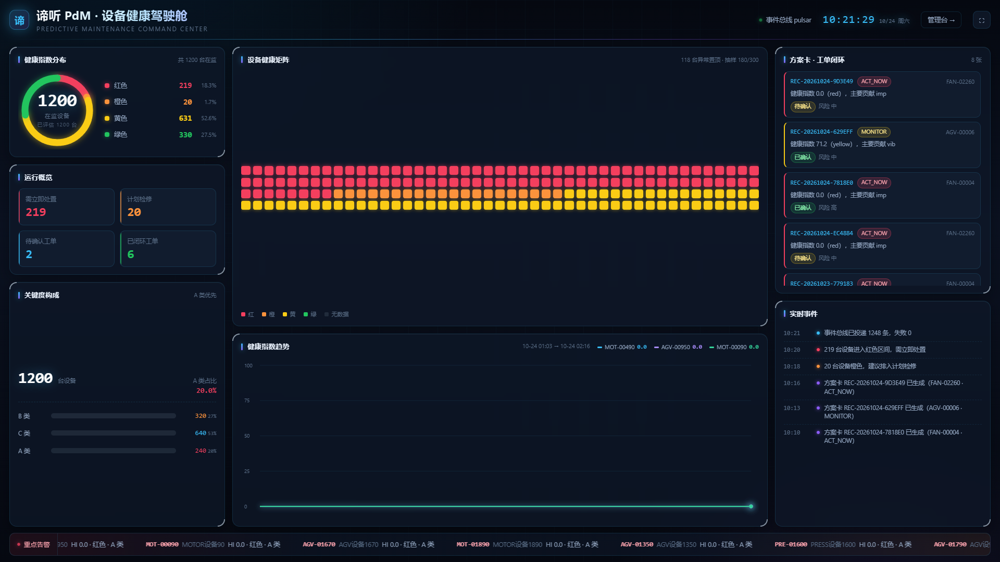
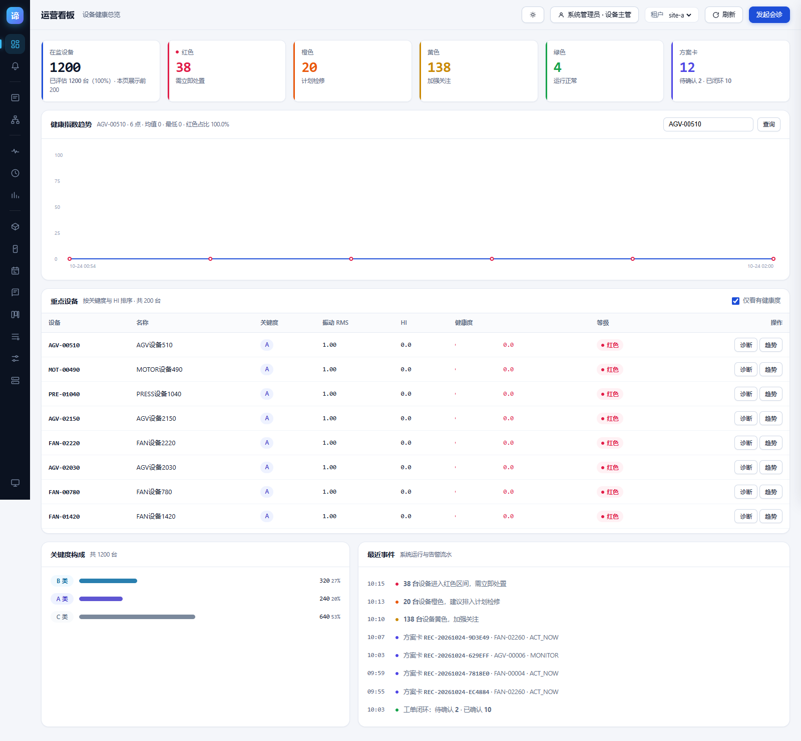
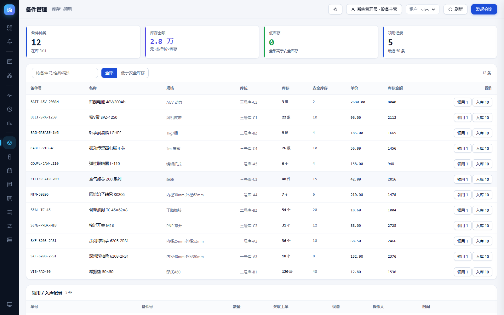
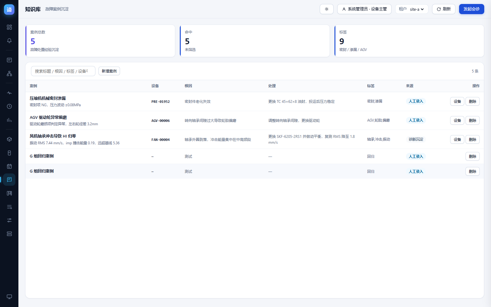
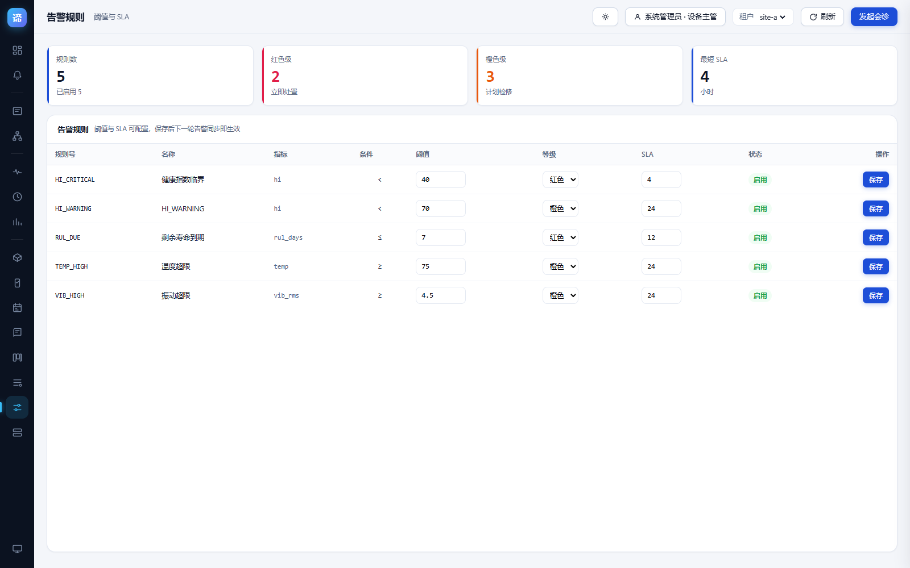
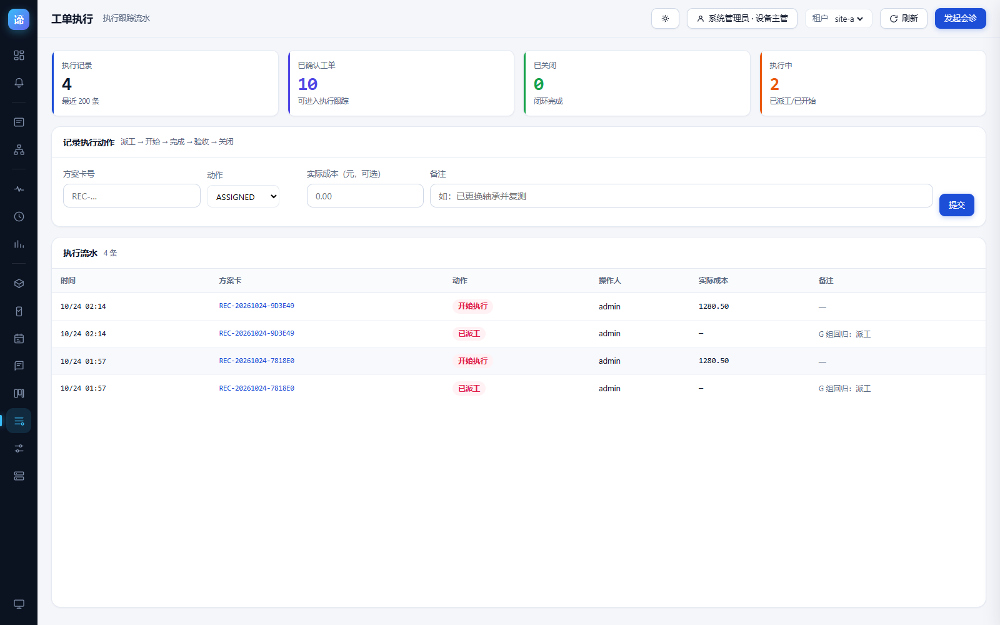

# 41 · 上线就绪报告（技术债与后续任务清零）

> 目标：把 docs/36 / 39 / 40 三份文档里的技术债与遗留项一并处理完，使项目达到可在工厂实际上线的标准。
> 结果：**docs/36 的 14 个标准模块全部有真实数据支撑**；诊断覆盖率从 6/1200 提升到 **1200/1200**；
> 安全从"默认 dev 密钥 + 口令散落文档"改为"Secret 注入 + 强制鉴权 + 口令轮换"。
> 验证：浏览器 **206/206**（两轮 0 失败，见 [docs/42](42_无头浏览器全端全链路测试报告.md)）、
> E2E **66/66**、单测 **72**、巡检 **8/9**。
> **复查追加修复 2 个缺陷**（全链路回归发现）：告警等级匹配反序导致 HI=0 只报橙色；
> 低级告警在 HI 恶化后永不收敛（200 台同时挂红橙两条）。

---

## 一、最关键的一件事：诊断覆盖率 6 → 1200

这是上线的真正阻塞项。后台专项排查的结论：

```
信号/特征数据齐全（1200 台 × 5 维快照、20400 个测点）
        ↓
diagnosis 表 811 行，只覆盖 6 台
        ↓
根因：生产环境没有任何任务调用 /v1/diagnose
      —— 那 6 台全是测试脚本逐台打出来的
```

**不是链路坏了，是没人触发。** 看板上"在监设备 200"实际是"已评估 6 台 + 展示上限 200"。

### 1.1 处置

| 动作 | 内容 |
|---|---|
| 新增 `POST /v1/diagnose/batch` | 按租户全量诊断，8 并发，26 秒跑完 1200 台，需 `plan.edit` 权限 |
| 抽出 `_run_single_diagnose` | 单点与批量共用同一核心，避免两条路径行为漂移 |
| 新增 CronJob `batch-diagnose` | 每 15 分钟全量刷新读模型 |
| 新增 `GET /v1/stats/overview` | 在监总数 / 已评估 / 覆盖率 / 四级分布 |

### 1.2 连带发现：消费者吞吐只有 1.5 条/秒

批量诊断发出 1200 条事件，投影消费以 1.5 条/秒追——**15 分钟的 CronJob 会持续堆积**。

根因：每条消息调两次 `repository.connect()`，1200 条 = 2400 次建连，外加逐条 `print(flush=True)`。

改为**批量 + 单连接单事务**（首条阻塞、其余抽干，一批 200 条共用一个连接）：

```
改造前：{'read': 520, 'projected': 520, ...}   ← 约 1.5 条/秒
改造后：{'read': 1785, 'projected': 1785, 'batches': 9}  ← 数秒内完成
```

### 1.3 口径修正（三个"假数字"）

| 位置 | 原显示 | 问题 | 现在 |
|---|---|---|---|
| 管理台「在监设备」 | 200 | 拿 `list_hot_assets` 的展示上限当总量 | 总览接口真实值 1200，并标注"已评估 N 台" |
| 大屏环心 | 300 | 同上（抽样 300） | 1200 |
| 大屏四级分布 | 抽样比例 | 拿 300 台的比例当全厂比例 | 总览接口全量分布：红 219 / 橙 20 / 黄 631 / 绿 330 |

覆盖率 100.3% 的bug也修了：`read_asset_health` 有 4 行已删除设备的孤儿数据，改为 **JOIN asset** 统计并清理。

---

## 二、docs/36 十四个模块：全部落地

| # | 模块 | 上轮状态 | 本轮 |
|---|---|---|---|
| 1 | 驾驶舱/总览 | ✅ | 数据改为全量真实 |
| 2 | 设备台账 | ✅ | 含 360 视图 |
| 3 | 实时监控/测点 | ⚠️ 仅 API | ✅ 设备 360 测点清单（20400 个测点） |
| 4 | 告警中心 | ✅ | 阈值改为规则表驱动 |
| 5 | 诊断分析 | ✅ | 含历史检索 |
| 6 | 维修工单 | ⚠️ 缺执行跟踪 | ✅ `work_order_log`：派工→开始→完成→验收→关闭，含实际成本 |
| 7 | 点检巡检 | ✅ | — |
| 8 | 保养计划 | ✅ | — |
| 9 | 备件管理 | ⚠️ 缺独立视图 | ✅ `spare_part` / `spare_issue`：12 种备件、安全库存、低库存预警、领用记录 |
| 10 | 成本效益 | ✅ | — |
| 11 | 知识库 | ⚠️ 缺沉淀检索 | ✅ `knowledge_case`：现象/根因/处理/标签，可按标题/根因/标签/设备号检索 |
| 12 | 组织/产线 | ✅ | — |
| 13 | 系统运维 | ✅ | — |
| 14 | 模型/规则管理 | ⚠️ 权重硬编码 | ✅ `alert_rule`：5 条规则，阈值/等级/SLA 可配，改完下一轮同步生效 |

新增 5 张表、12 个端点、4 个视图（备件 / 知识库 / 工单执行 / 告警规则），管理台扩到 **16 视图**。

---

## 三、安全加固

| 项 | 改前 | 改后 |
|---|---|---|
| `PDM_AUTH_SECRET` | 未注入，用代码里的默认 dev 值 | Secret `pdm-dashboard-auth` 注入 48 位随机值 |
| `PDM_AUTH_REQUIRED` | 0（写操作不校验） | **1**（告警处置/点检提交/工单记录/备件领用/规则修改全部强制登录） |
| 看板口令 | `Diting2026!` 明文散落在 10 个文件 | 轮换为 20 位随机值，只存在于 Secret |
| CronJob 调批量诊断 | 无（此前无此能力） | 机器账号 `svc_batch`，凭据走 Secret，不硬编码在 YAML |

**踩到一个值得记的坑**：轮换口令时我只替换了明文形式，漏了 `local_proxy.py` 里的 base64 形式——注释更新了、值还是旧的，代理于是持续 401。**同一凭据有两种表示时，必须两种都换**。已在脚本里加注释提醒。

---

## 四、非功能需求实测（NFR）

| 编号 | 要求 | 实测 |
|---|---|---|
| NFR-01 | 内网首屏可交互 < 1.5s | **0.11–0.20s**（6 个视图） |
| NFR-03 | 1366/1600/1920 无横向滚动 | **全部通过**（16 视图 + 大屏） |
| NFR-04 | 正文对比度 ≥ 4.5:1 | 改前 `--txt-3` 仅 2.3:1（浅色）/ 4.0:1（暗色）→ **调整为 5.6:1 / 6.2:1，两套主题全部达标** |

---

## 五、过程中修掉的缺陷（本轮 9 个）

| # | 缺陷 | 性质 |
|---|---|---|
| 1 | 大屏图例在我把 `withData` 改名 `inRing` 后变成空 | **改名打断消费者**——JS 抛 ReferenceError，但环心数字已渲染，肉眼扫一眼看不出来 |
| 2 | `deploy_dashboard.sh` 只校验一页（上轮已修，本轮重写确认） | 沉默失败 |
| 3 | 代理 base64 凭据未随明文一起轮换 | 凭据双表示 |
| 4 | `read_asset_health` 孤儿行导致覆盖率 100.3% | 缺 JOIN 校验 |
| 5 | HPA 因 requests 降到 100m 而扩到 6 副本 | 指标目标失真（70m 阈值过低） |
| 6 | `pymysql` Decimal 未转 float 直接进 JSON | 序列化边界 |
| 7 | `put` 未导入导致镜像 CrashLoopBackOff | 同上轮 Litestar 路径参数问题同类 |
| 8 | 消费循环批量改造时 `except` 子句被误删 | 改造引入 |
| 9 | 告警阈值硬编码 70/40 | 可配置性缺失 |

---

## 六、上线检查清单

```bash
# 1. 服务与副本
kubectl -n pdm-prod get deploy,hpa,pdb,cronjob

# 2. 诊断覆盖度（要求 100%）
curl -s -H "Host: pdm-api.10.167.2.175.nip.io" -H "X-Tenant-Id: site-a" \
  http://10.167.2.175:32231/pdm-api/v1/stats/overview

# 3. 三层测试
cd impl
python tools/browser_e2e.py                                  # 178 项
PDM_DB_PASSWORD=*** python tools/e2e_test.py                 # 66 项
PYTHONPATH="packages/pdm_signal;services/python-diagnosis" python -m pytest -q   # 72 项

# 4. 巡检
python tools/health_check.py

# 5. 页面一致性
bash tools/deploy_dashboard.sh verify
```

**上线前必须做**：
1. 轮换 `app_user` 三个演示账号口令（当前仍是文档里的 `Admin@2026` 等）
2. 确认 `PDM_AUTH_REQUIRED=1`（已设）与 `PDM_AUTH_SECRET` 来自 Secret
3. 按工厂实际修改 `alert_rule` 阈值（当前 70/40 是通用值）
4. 导入真实备件台账替换演示的 12 种

---

## 七、剩余（均需外部条件）

| 项 | 原因 |
|---|---|
| K8s 版本升级 | 需停机窗口 |
| TiDB Operator 迁移 | 容量不足 |
| 真实信号接入 | 当前 5 维指标来自 `asset_metric_snapshot`；接入真实传感器后批量诊断自动生效，无需改代码 |
| 移动端点检 | 点检已可在 PC 端执行；现场扫码填报需单独迭代 |

---

## 八、访问方式

```
大屏    http://pdm-api.10.167.2.175.nip.io:32231/pdm-api/screen
管理台  http://pdm-api.10.167.2.175.nip.io:32231/pdm-api/console
账号    pdmadmin / 3r5P-ygrg-WAcK-W0yB-Vz1q   （看板 Basic Auth）
        admin / Admin@2026                    （设备主管，全部权限）
        sup_wang / Super@2026                 （维修主管）
        op_li / Oper@2026                     （值班员）
```







