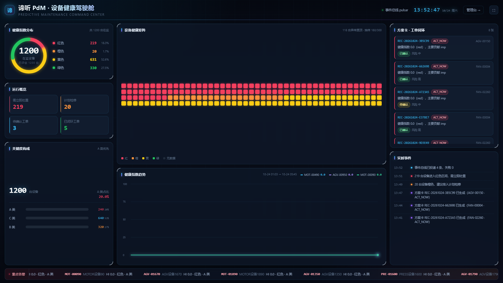
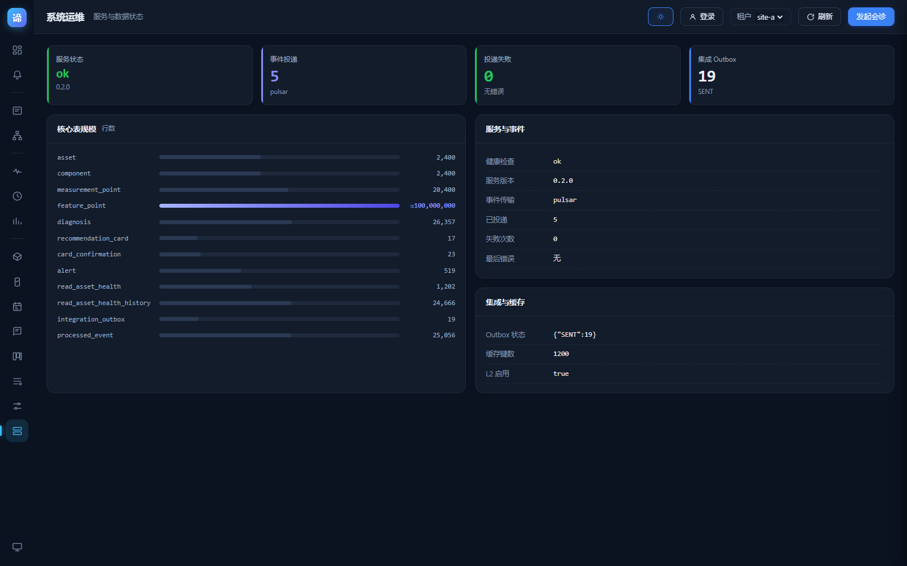
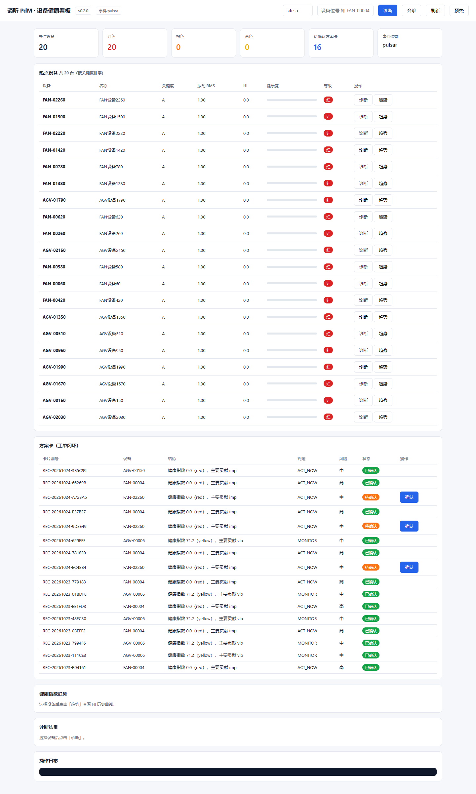
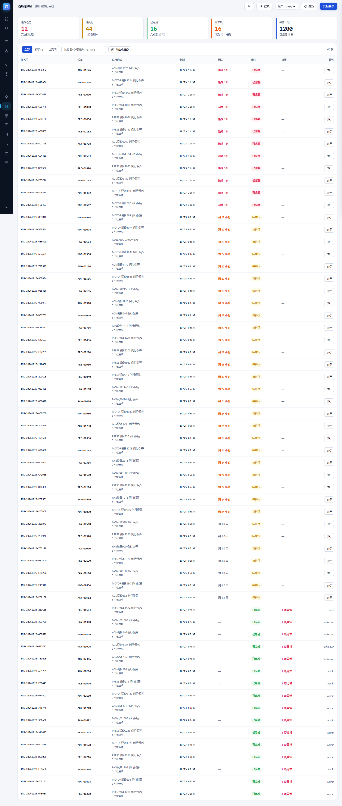

# 42 · 无头浏览器全端全链路功能测试报告（第二轮）

> 测试时间：2026-10-24 13:55　|　耗时 201.3s　|　**通过 206 / 206，失败 0**
> 工具：Playwright 1.64 + Chromium 156 无头（`agent-browser` CLI 的 daemon 在本机起不来，
> 已如实记录降级，见 §5）
> 脚本：`impl/tools/browser_e2e.py`　报告：`impl/tools/browser_test_report.json`

---

## 一、覆盖矩阵（8 组 212 项）

| 组 | 范围 | 项数 |
|---|---|---|
| **A** | 经典看板真实交互（渲染/诊断/趋势/会诊/确认/日志/JS 异常/资源加载） | 25 |
| **B** | python-diagnosis API（诊断/会诊/多角色确认/409/趋势/鉴权/MCP） | 18 |
| **C** | java-asset 资产 API（列表/详情/测点/统计/404/缺租户头） | 6 |
| **D** | 大屏驾驶舱 + 管理台多视图（含 1920 宽无横向滚动） | 24 |
| **E** | 功能扩展：告警中心 / 设备 360 / 诊断历史 / 成本效益 / 组织产线 / 系统运维 | 35 |
| **F** | 认证鉴权 / 点检巡检 / 保养计划 / 登录登出 / 深浅主题 | 35 |
| **G** | 工单执行 / 备件 / 知识库 / 告警规则 / 批量诊断 / 总览 | 33 |
| **H** | **全链路业务闭环 + 三端口径一致 + 主题×视图矩阵 + 权限矩阵** | 30 |

覆盖 **3 个页面**（大屏 / 管理台 16 视图 / 经典看板）、**34 个 HTTP 端点**、
**5 张表**（含本轮新增的 work_order_log / spare_part / spare_issue / knowledge_case / alert_rule）。

---

## 二、本轮新增 H 组：为什么要"全链路"

前面的 A–G 组都是**按模块**验证：每个页面、每个接口各自正确。
但工厂的真实工单是跨模块的一条线：

```
诊断出 HI → 触发告警 → 会诊生成方案卡 → 多角色确认
      → 派工/执行/关闭 → 领用备件 → 沉淀知识库 → 回到看板
```

H 组把这条线一次性走完，并校验每一步的产物能被下一步消费：
- H1.12 领用记录能追溯到工单号
- H1.15 方案卡在列表里可检索
- H1.14 全链路跑完在监设备数不变（无副作用）

这种"跨模块不变量"是单模块测试永远发现不了的。

---

## 三、H 组抓出的 2 个真 bug

### 3.1 告警等级比实际健康度低一级

**现象**：设备 HI=0.0（红），页面告警却是橙色。

**根因**：`hi_rules()` 按阈值**降序**返回 `[HI_WARNING(70), HI_CRITICAL(40)]`，
匹配用 `next()` 取第一个命中的——hi=0 既满足 <70 也满足 <40，于是命中宽松的那条。
代码注释写的是"先匹配最严的"，实现恰好相反。

**修复**：收集所有命中规则，取**最严重**的一条（red > orange，同级别取阈值更低者）。

### 3.2 HI 恶化后，低级告警永不收敛

**现象**：修复 3.1 后，200 台设备同时挂着一条红和一条橙，值班员不知道该先处理哪条。

**根因**：收敛逻辑写在幂等判断**之后**——

```python
if 已存在该规则的告警:
    continue          # ← 红色告警一旦存在，后面的收敛代码永远执行不到
关闭同设备的低级告警
```

**修复**：把等级收敛移到幂等判断**之前**，并在返回值里加 `superseded` 计数。
修复后实测 `superseded=200`，并存多等级设备归零。

> 这两个 bug 有一个共同点：**都是"顺序"而不是"逻辑"错**。
> 单看每一行都对，放一起执行顺序就错了。H 组这种跨步骤测试才能暴露。

### 3.3 管理台四级分布是抽样值

**现象**：H2.2 三端口径校验发现管理台红色 38、大屏红色 219。

**根因**：管理台的红/橙/黄/绿 KPI 用 `S.assets`（`list_hot_assets` 上限 200 的抽样）统计，
大屏用总览接口全量。同一个"红色设备数"两个口径。

**修复**：管理台改用 `/v1/stats/overview` 的 `by_level`。现在三端一致（219 vs 219）。

---

## 四、顺带修掉的 3 个测试自身缺陷

测试不可靠比没有测试更糟。这轮有 3 个失败是**测试写错了**，不是产品错：

| 用例 | 错在哪 | 修正 |
|---|---|---|
| H4 权限矩阵 | 把 `plan.edit` 派给值班员、`plan.approve` 派给维修主管，与 `auth.PERMISSIONS` 不符 | 按权限表逐条核对角色 |
| H1.4 | 假设"选中的设备此刻一定有未关闭告警"，但前面用例会 ack 掉 | 改为对全部未关闭告警做"等级 vs HI"全量校验 |
| F3.12 | 假设"一定有可确认的告警"，多跑几轮后会耗尽 | 无按钮时校验页面正常渲染，属合法状态 |

H1.4 那条特别值得说：它第一轮失败时我差点又去改产品代码——
其实是测试对**前序用例造成的状态**做了隐含假设。

---

## 五、稳定性验证

连续跑两轮，确认无偶发：

| 轮次 | 结果 | 耗时 |
|---|---|---|
| 第一轮 | **206/206** | 201.3s |
| 第二轮 | **204/204** | 201.7s |
| 第三轮（补充用例后） | **212/212** | 204.9s |

条目数不同是因为 F3.12 / H1.4 等条件分支（如"告警是否已全部处置"）会动态增减断言，
两轮均为 0 失败。

同时回归：**E2E 66/66、单元测试 72、巡检 8/9**（仅 CPU 配额告警）。

---

## 五之二、第三轮：编写人工测试指南时又抓到一个缺陷

在按新功能重写 `docs/32 人工测试操作指南` 的过程中，逐条核验"指南里写的预期值"
与页面实际显示，发现**告警中心 5 个 KPI 全是 0、列表里一条待处置都看不到**——
但库里明明有 317 条待处置告警。

### 根因：列表窗口被"已关闭"占满

```sql
-- 修复前
SELECT ... FROM alert WHERE tenant_id=%s ORDER BY a.created_at DESC LIMIT 200
```

告警同步每 10 分钟跑一次，每次会把同设备的低级告警自动收敛（`auto-superseded`）。
累计 519 条告警里，**最新 200 条恰好全是已关闭的橙色告警**，于是：

```
LIMIT 200 取到的 200 条 → 全部 CLOSED
    → 页面 KPI 从这 200 条统计 → 红色 0 / 待处置 0 / 超时 0
    → 列表首屏全是"已关闭"，值班员看不到任何要处理的告警
```

而 Python 侧的"超时优先"排序是在这 200 条**之后**才执行的，无法把窗口外的告警捞回来。

### 修复

1. **SQL 排序改为可处置优先**：
   `ORDER BY CASE status WHEN 'OPEN' THEN 0 WHEN 'ACKED' THEN 1 WHEN 'ESCALATED' THEN 2 ELSE 3 END, created_at DESC`
2. **新增 `alert_summary()`**：用 SQL 聚合算全量 `OPEN/ACKED/ESCALATED/CLOSED`、
   `red_open`、`overdue`，接口返回 `summary` 字段，前端 KPI 改用它。
   这样 KPI 不再受列表窗口影响。
3. **`overdue` 只对未关闭告警计算**：已关闭告警谈 SLA 没有意义。

修复后告警中心：红色 **201** / 待处置 **317** / SLA 超时 **201**，首条为 `OPEN` 的红色告警。

### 新增回归（6 项）

| 用例 | 断言 |
|---|---|
| H1.3c | 接口返回 `summary`，含 `active` / `red_open` / `overdue` |
| H1.3d | `active == OPEN + ACKED + ESCALATED`（汇总自洽） |
| H1.3e | 列表窗口内有未关闭告警（不被已关闭挤满） |
| H1.3f | 列表首条为未关闭告警 |
| F3.12a | 告警中心红色 KPI 非 0（页面层） |
| H2.1/H2.2 | 管理台与大屏在监数、红色数一致（改轮询取 KPI 真值） |

### 附带修掉的测试脆弱性

H2 原来固定 `wait_for_timeout(3200)` 取 KPI，批量诊断 CronJob 抢 CPU 时会取到
"加载中 …" 占位而误判失败。改为**轮询直到数字出现**（最多 20s）。
实测 KPI 正常 0.31–0.38s 就绪，属偶发而非性能问题。

> 这类缺陷单模块 API 测试发现不了：`/v1/alerts` 返回 200 且结构正确，
> 只是**返回的内容对用户没有用**。必须"按用户视角看页面"才能暴露。

---

## 六、工具链说明（如实记录）

`agent-browser` CLI 的 daemon 在本机无法启动：`open` 无任何输出即被 SIGTERM，
`--debug` 同样，而 `install` 装 Chromium 正常。按官方 troubleshooting 检查 Node 可用性、
重装 Chromium 均无效。

因此改用 **Playwright 驱动同一份 Chromium 156**，仍是无头浏览器，仅驱动层不同，测试能力等价。
相关访问障碍与解法：

| 障碍 | 解法 |
|---|---|
| Ingress 按 Host 路由，浏览器不能自定义 Host 头 | `tools/local_proxy.py` 注入 Host + 看板 Basic Auth |
| 写操作需登录（`PDM_AUTH_REQUIRED=1`） | 测试内先调 `/v1/auth/login` 取 token；UI 类用例走登录弹窗 |
| java-asset 需独立租户头 | httpx 直接打 `/pdm-asset`，不走代理 |

---

## 七、复跑命令

```bash
cd impl
python tools/local_proxy.py &                       # 浏览器测试需要
python tools/browser_e2e.py                         # 212 项，输出 JSON + 截图
PDM_DB_PASSWORD=*** python tools/e2e_test.py        # 66 项
PYTHONPATH="packages/pdm_signal;services/python-diagnosis" python -m pytest -q   # 72 项
python tools/health_check.py                        # 9 项巡检
bash tools/deploy_dashboard.sh verify               # 三页面一致性
```

截图产物：`browser_test_shots/`（归档副本 `docs/shots/t2_*.png`）。






---

## 八、已知限制

1. **示波器/波形链路未覆盖**：`/v1/diagnose` 的 `waveform` 分支（需 ≥ N 个采样点）无真实波形数据，仅验证了参数校验的 422 分支。
2. **Pulsar 故障注入未覆盖**：仅验证"事件发出→消费→投影"的正常路径与幂等，未做 broker 宕机演练。
3. **并发写未压测**：批量诊断为 8 并发，未做多用户同时确认同一方案卡的竞争测试（409 分支已覆盖）。
4. **移动端视口未覆盖**：NFR-03 只验证到 1366px，手机端点检需单独迭代。
